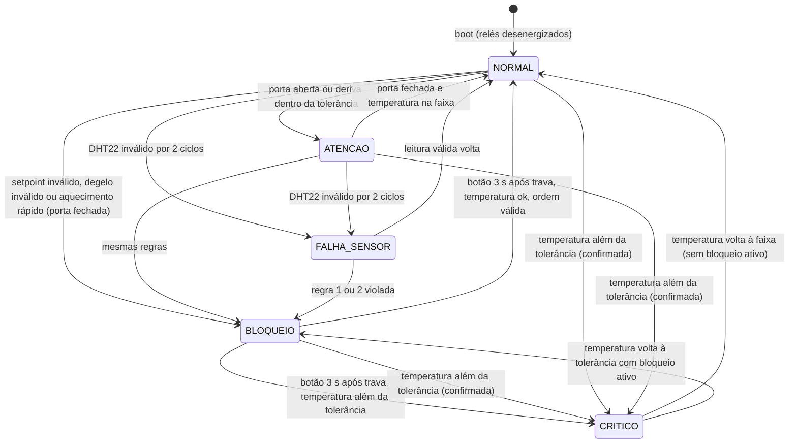

# Design — Edge do C-Shield

Projeto: C-Shield · Nexus Vision · GS 2026.2 "CitizenTech" · FIAP. Requisitos: `requirements.md` (R1 a R46). Plano: `PLANO-CSHIELD.md`.

## 1. Módulos e responsabilidades

Pasta do firmware: `edge/cshield/` (a pasta e o `cshield.ino` têm o mesmo nome, exigência do Arduino).

| Arquivo | Responsabilidade | Depende de Arduino? | Requisitos |
| --- | --- | --- | --- |
| `config.h` | Todas as constantes: pinos, perfis, limites, tempos, rede, textos | Não | R40, R41, R42 |
| `decisao.h` | Lógica pura: estados, regras de bloqueio, taxa, exposição, trava, liberação | **Não** (testável com `g++`) | R14 a R32, R46 |
| `sensores.h` | Leitura do DHT22, LDR, potenciômetro e GPIO 18; validação; média móvel; monta a `Leitura` | Sim | R6 a R13 |
| `atuadores.h` | Relés (estado seguro no boot), LED RGB por estado, padrões do buzzer com `millis()` | Sim | R1, R5, R17, R18, R44 |
| `painel.h` | Telas do LCD 16x2 I2C; só reescreve quando o conteúdo muda | Sim | R43, R42 |
| `rede.h` | Wi-Fi, NTP (hora), MQTT **somente publish**, reconexão a cada 10 s, monta o payload | Sim | R2, R3, R4, R33 a R36 |
| `cshield.ino` | `setup()` e `loop()`: só orquestra e imprime a linha do Serial | Sim | R1, R39, R44, R45 |
| `test/test_decisao.cpp` | Um teste por requisito de decisão | Não | R14 a R32 |
| `fiware/provisionar.sh` | Cria o device sem comandos e a subscription do STH-Comet | — | R37 |

Regra de dependência: `decisao.h` inclui só `config.h` (que também não inclui `Arduino.h`). Os módulos de hardware chamam `decisao.h`; `decisao.h` nunca chama hardware. Assim a lógica que vale nota é testada no computador, sem placa.

## 2. Máquina de estados



O estado final é sempre o de maior prioridade: **CRITICO > BLOQUEIO > FALHA_SENSOR > ATENCAO > NORMAL**. O bloqueio é uma *condição persistente* (`Contexto.bloqueado`), separada do estado exibido: no CRITICO com bloqueio ativo, os relés permanecem cortados mesmo depois que a temperatura volta para dentro da tolerância, até a liberação presencial.

## 3. Estruturas de `decisao.h`

```cpp
enum Estado { ST_NORMAL, ST_ATENCAO, ST_BLOQUEIO, ST_CRITICO, ST_FALHA_SENSOR };

enum Motivo {
  MT_NENHUM, MT_PORTA_ABERTA, MT_DERIVA, MT_SETPOINT_INVALIDO,
  MT_DEGELO_FORA_HORARIO, MT_DEGELO_LONGO, MT_AQUECIMENTO_RAPIDO,
  MT_TEMP_FORA_TOLERANCIA, MT_SENSOR_SEM_LEITURA
};

struct Perfil { float tMin; float tMax; float tolerancia; };

// Entrada de um ciclo de decisão (montada por sensores.h; nos testes, preenchida à mão).
struct Leitura {
  bool  valida;          // DHT22 devolveu valor utilizável neste ciclo
  float temperatura;     // °C, já suavizada pela média móvel
  float umidade;         // %
  float luzPct;          // % do LDR
  bool  temSetpoint;     // false na maquete (sem potenciômetro)
  float setpoint;        // °C observado no controlador
  bool  degelo;          // degelo comandado (GPIO 18)
  bool  horaValida;      // hora do NTP disponível
  int   hora;            // 0..23, só vale se horaValida
  bool  liberacao;       // botão segurado por LIBERACAO_MS (calculado em sensores.h)
};

// Memória entre ciclos. Zerada por iniciarContexto().
struct Contexto {
  bool          bloqueado;        // condição persistente de bloqueio
  unsigned long inicioBloqueioMs; // base da trava mínima
  Motivo        motivoBloqueio;
  int           bloqueios;        // contador `bq`
  float         exposicao;        // °C·min acumulados (`ex`)
  unsigned long ultimoMs;         // para integrar Δt
  unsigned long inicioDegeloMs;   // 0 quando o degelo não está ativo
  int           contCritico;      // ciclos seguidos além da tolerância
  int           contInvalido;     // ciclos seguidos com sensor inválido
  float         histTemp[N_AMOSTRAS_TAXA]; // histórico para a taxa (60 s)
  unsigned long histMs[N_AMOSTRAS_TAXA];
  int           histN;
  float         ultimoSetpoint;   // para registrar mudanças ignoradas na trava
  bool          ultimoDegelo;
};

// Saída de um ciclo de decisão.
struct Decisao {
  Estado estado;
  Motivo motivo;
  bool   cortaAquecedor;   // relé 1 abre o NF
  bool   ligaVentoinha;    // relé 2 fecha o NA
  bool   novoBloqueio;     // true só no ciclo em que o bloqueio começou (gera evento)
  bool   mudancaIgnorada;  // true quando a trava descartou uma ordem (registrar no Serial)
  float  taxaCPorMin;      // para o Serial
  float  exposicao;        // °C·min, para `ex`
  unsigned long travaRestanteMs; // 0 quando a trava já passou
};
```

## 4. Funções públicas

`decisao.h` (sem Arduino):

```cpp
Perfil perfilAtivo();                                    // lê a constante PERFIL_* de config.h
void   iniciarContexto(Contexto& ctx);
Decisao avaliar(const Leitura& l, Contexto& ctx, unsigned long agoraMs);
float  calcularTaxa(const Contexto& ctx);                // °C/min sobre JANELA_TAXA_MS
bool   portaAberta(float luzPct);                        // luzPct > LIMIAR_PORTA_PCT
bool   degeloPermitidoNaHora(int hora);                  // janelas de HORA_DEGELO_1/2
const char* nomeEstado(Estado e);                        // "NORMAL", "BLOQUEIO"...
const char* nomeMotivo(Motivo m);                        // "SETPOINT_INVALIDO"... ("-" se nenhum)
```

`sensores.h`:

```cpp
void   iniciarSensores();
bool   lerSensores(unsigned long agoraMs, Leitura& saida); // true quando houve novo ciclo (a cada 2 s)
float  mediaMovel(float novo);                             // janela JANELA_MEDIA
float  luminosidadePct();                                  // LDR → 0..100
float  setpointObservado();                                // potenciômetro → °C (ou -999)
bool   degeloComandado();                                  // GPIO 18
bool   botaoLiberacaoSegurado(unsigned long agoraMs, int& progressoPct); // debounce + 3 s
```

`atuadores.h`:

```cpp
void iniciarReles();                          // PRIMEIRA coisa do setup(): desenergiza os dois
void aplicarReles(bool cortaAquecedor, bool ligaVentoinha);
void aplicarLed(Estado e, unsigned long agoraMs);     // cor e pisca por estado
void aplicarBuzzer(Estado e, unsigned long agoraMs);  // padrões não bloqueantes
```

`painel.h`:

```cpp
void iniciarPainel();
void mostrarBoot();
void mostrarEstado(const Decisao& d, const Leitura& l, const Perfil& p, unsigned long agoraMs);
void mostrarLiberacao(int progressoPct);      // "LIBERANDO..." + barra de 16 blocos
```

`rede.h` (só publicação):

```cpp
void iniciarRede();                            // WiFi.begin + configTime (NTP); não bloqueia
void atualizarRede(unsigned long agoraMs);     // reconexão a cada 10 s, sem travar
bool redeOk();
bool horaAtual(int& hora);                     // true se o NTP já respondeu
void montarPayload(char* buf, size_t n, const Leitura& l, const Decisao& d, int bloqueios);
void publicarSePreciso(const char* payload, Estado estado, unsigned long agoraMs);
                                               // a cada 5 s e imediata na mudança de estado
```

## 5. Ordem de avaliação dentro de `avaliar()`

1. **Sensor.** Se `!l.valida`, incrementa `contInvalido`; com 2 ciclos seguidos, candidato FALHA_SENSOR. Caso contrário zera `contInvalido` e atualiza o histórico e a exposição.
2. **Trava ativa** (`ctx.bloqueado`): ordens novas do controlador são ignoradas e registradas (R25); só avalia liberação (passo 6) e CRITICO.
3. **Regras de bloqueio** (só se não bloqueado), na ordem: setpoint (R20) → degelo longo (R21) → degelo fora do horário (R22) → aquecimento rápido (R23, pulada em FALHA_SENSOR e com porta aberta). A primeira violada liga `ctx.bloqueado`, grava `inicioBloqueioMs` e o motivo, incrementa `bloqueios` e marca `novoBloqueio`.
4. **Exposição.** Se a temperatura passa de `T_MAX`, soma `(T − T_MAX) × Δt` (R31).
5. **CRITICO.** Temperatura além da tolerância por `CONFIRMACOES` ciclos (R18, R9).
6. **Liberação.** Se `ctx.bloqueado` e `l.liberacao` e a trava mínima passou: `bloqueado = false`. Se a temperatura está além da tolerância, o resultado é CRITICO (R27); se a ordem continua inválida, a reavaliação seguinte bloqueia de novo (R28).
7. **Estado final** por prioridade (R19) e preenchimento de `cortaAquecedor` e `ligaVentoinha`: ambos verdadeiros se `bloqueado` ou CRITICO; falsos nos demais.

## 6. Fluxo de um ciclo do `loop()`

```
setup():
  iniciarReles()            <- primeiro (R1)
  Serial.begin, iniciarSensores, iniciarPainel, mostrarBoot
  iniciarContexto(ctx)
  iniciarRede()             <- WiFi.begin, configTime; não espera conexão

loop():
  agora = millis()
  atualizarRede(agora)      <- reconexão a cada 10 s, sem bloquear
  se lerSensores(agora, leitura):         // a cada 2 s
      leitura.horaValida = horaAtual(leitura.hora)
      decisao = avaliar(leitura, ctx, agora)
      aplicarReles(decisao.cortaAquecedor, decisao.ligaVentoinha)
      imprimirSerial(...)                 // linha da seção 2.7 do plano (R39)
      montarPayload + publicarSePreciso   // imediata se mudou de estado ou novoBloqueio
  aplicarLed(estado, agora)               // pisca e buzzer rodam a cada loop, com millis()
  aplicarBuzzer(estado, agora)
  painel: se botão segurado → mostrarLiberacao(progresso)
          senão mostrarEstado(...) (só reescreve se o conteúdo mudou)
```

O `loop()` roda livre; só a decisão, o Serial e a publicação acontecem a cada 2 s. Nenhum passo bloqueia: sem `delay()`, e a rede é tentada com intervalo.

## 7. Wokwi (`diagram.json`)

Componentes: `wokwi-esp32-devkit-v1`, `wokwi-dht22`, `wokwi-photoresistor-sensor`, `wokwi-potentiometer` (setpoint, rótulo "Setpoint do controlador"), `wokwi-slide-switch` (degelo, rótulo "Degelo do controlador"), `wokwi-pushbutton` (liberação), dois `wokwi-relay-module`, `wokwi-rgb-led` com três resistores de 220 Ω, `wokwi-buzzer`, `wokwi-lcd1602` com `"pins": "i2c"` e dois LEDs indicadores (laranja "aquecedor" no NF do relé 1, azul "ventoinha" no NA do relé 2) com resistor de 220 Ω. Cores de fio: vermelho para 3V3/5V, preto para GND, verde para sinais, azul para I2C. O LCD no Wokwi é alimentado em 5 V (VIN do ESP32).

Ressalva: os nomes de pino dos componentes `wokwi-relay-module` e `wokwi-lcd1602` devem ser conferidos na documentação do Wokwi antes de escrever o `diagram.json` (T15), pois o `diagram.json` da Vinheria não usa nenhum dos dois.

## 8. Decisões de projeto

- **`bloqueado` separado do `estado`.** Permite CRITICO com bloqueio ativo mantendo os relés cortados (R18) e reaplicar o bloqueio depois da liberação (R28).
- **Liberação como booleano na `Leitura`.** O debounce e os 3 s vivem em `sensores.h`; `decisao.h` só vê `liberacao`. Assim o teste de liberação não precisa simular botão.
- **Taxa e exposição dentro do `Contexto`.** O histórico de 60 s fica em `decisao.h` (vetor fixo `N_AMOSTRAS_TAXA`), sem alocação dinâmica, para ser testável e seguro em microcontrolador.
- **Tempo injetado (`agoraMs`).** `avaliar()` não chama `millis()`; os testes controlam o relógio.
