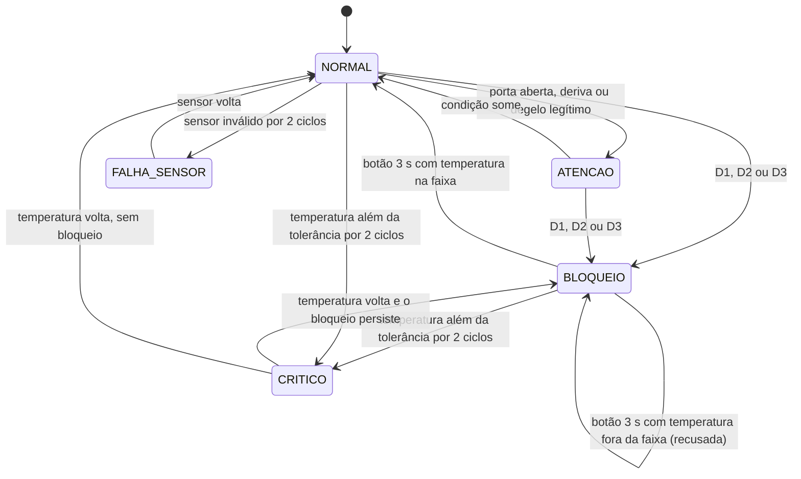
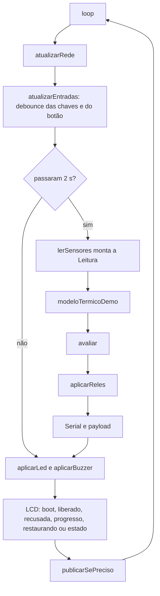

# Design — Edge do C-Shield (versão 2)

Projeto: C-Shield · Nexus Vision · GS 2026.2 "CitizenTech" · FIAP. Requisitos: `requirements.md` (R1 a R49). Plano: `PLANO-CSHIELD.md`.

## 1. Módulos e responsabilidades

| Arquivo | Responsabilidade | Depende de Arduino? | Requisitos |
| --- | --- | --- | --- |
| `config.h` | Todas as constantes: pinos, perfis, limites, tempos, rede, textos | Não | R11, R18, R44 |
| `decisao.h` | Lógica pura: `avaliar()` (regras D1 a D3, termostato, ordens ignoradas, exposição) e `liberar()` | **Não** (testável com `g++`) | R12 a R31 |
| `decisao_tipos.h` | Estados, motivos e as estruturas `Leitura`, `Contexto` e `Decisao` | **Não** | R12 a R31 |
| `decisao_regras.h` | Auxiliares puras: validação, janela de degelo, nomes, histórico e taxa | **Não** | R6, R17, R18 |
| `sensores.h` | DHT22, LDR, chaves do controlador com debounce, botão, média móvel; monta a `Leitura` | Sim | R6 a R10 |
| `atuadores.h` | Relés (repouso no boot), LED RGB por estado, buzzer com `millis()` | Sim | R1, R32, R33 |
| `painel.h` | Telas do LCD 16x2 I2C; só reescreve quando o texto muda | Sim | R34 a R36 |
| `simulacao.h` | Modelo térmico só da demo no Wokwi (`MODELO_TERMICO_DEMO`) | Não | R48 |
| `rede.h` | Wi-Fi, NTP, MQTT **somente publish**, reconexão com sonda TCP, monta o payload | Sim | R2 a R4, R39, R40 |
| `cshield.ino` | `setup()` e `loop()`: só orquestra; Serial | Sim | R37, R38, R45 |

A lógica foi dividida em três arquivos puros (tipos, regras e decisão) para nenhum passar de ~250 linhas.

## 2. Máquina de estados

O bloqueio é uma condição persistente (`Contexto.bloqueado`) separada do estado mostrado. O estado mostrado segue a prioridade CRITICO > BLOQUEIO > FALHA_SENSOR > ATENCAO > NORMAL.



## 3. Estruturas

```cpp
enum Estado { ST_NORMAL, ST_ATENCAO, ST_BLOQUEIO, ST_CRITICO, ST_FALHA_SENSOR };
enum Motivo { MT_NENHUM, MT_PORTA_ABERTA, MT_DERIVA, MT_DEGELO, MT_DEGELO_FORCADO,
              MT_AQUECEDOR_LONGO, MT_SUBIDA_RAPIDA, MT_TEMP_FORA_TOLERANCIA, MT_SENSOR_SEM_LEITURA };

struct Leitura {
  bool valida; float temperatura; float umidade; float luzPct;
  bool aquecedorCmd; bool ventoinhaCmd;       // o que o controlador está mandando
  bool horaValida; int minutoDoDia;           // 0..1439
  bool liberacao;                             // botão segurado por 3 s
};

struct Contexto {
  bool iniciado; unsigned long ultimoMs;
  bool bloqueado; Motivo motivoBloqueio;
  bool aquecedorAtivo; unsigned long inicioAquecedorMs;
  bool termostatoLigado;
  int bloqueios; int ignorados;               // bq e ci
  float exposicao; int contCritico; int contInvalido;
  float histTemp[N_AMOSTRAS_TAXA]; unsigned long histMs[N_AMOSTRAS_TAXA]; int histN;
  bool ultimoAq; bool ultimoVt;
};

struct Decisao {
  Estado estado; Motivo motivo;
  bool cortarAquecedor; bool ligarVentoinha;  // relé 1 e relé 2
  bool novoBloqueio; bool mudancaIgnorada;
  bool liberou; bool liberacaoRecusada;
  float taxaCPorMin; float exposicao;
  unsigned long degeloRestanteMs;             // contagem do degelo legítimo
  unsigned long aquecedorLigadoMs;            // para a linha de evento do Serial
};
```

## 4. Assinaturas públicas

```cpp
// decisao.h (puro)
void        iniciarContexto(Contexto&);
bool        degeloNoHorario(const Leitura&);         // MODO_DEMO ou sem hora válida: true
bool        liberar(const Leitura&, Contexto&);      // true se a liberação foi aceita
Decisao     avaliar(const Leitura&, Contexto&, unsigned long agoraMs);
const char* nomeEstado(Estado);
const char* nomeMotivo(Motivo);

// sensores.h
void iniciarSensores();
bool lerSensores(unsigned long agoraMs, Leitura& saida);   // true a cada 2 s
void atualizarEntradas(unsigned long agoraMs);             // debounce das chaves e do botão, a cada volta
bool botaoConsumirLiberacao();
int  botaoProgressoPct();

// atuadores.h
void iniciarReles(); void iniciarLedRgb(); void iniciarBuzzer();
void aplicarReles(bool cortarAquecedor, bool ligarVentoinha);
void aplicarLed(Estado, unsigned long agoraMs);
void aplicarBuzzer(Estado, unsigned long agoraMs);

// painel.h
void iniciarPainel(); void mostrarBoot();
void mostrarEstado(const Decisao&, const Leitura&, unsigned long agoraMs);
void mostrarRestaurando(); void mostrarLiberacao(int progressoPct);
void mostrarLiberado();   void mostrarForaDaFaixa();

// simulacao.h
float modeloTermicoDemo(float medida, bool noControle, bool ventoinhaEfetiva, unsigned long agoraMs);

// rede.h
void iniciarRede(); void atualizarRede(unsigned long agoraMs);
bool redeOk(); bool horaAtual(int& minutoDoDia);
void montarPayload(char* buf, size_t n, const Leitura&, const Decisao&, const Contexto&);
bool publicarSePreciso(const char* payload, Estado, bool& evento, unsigned long agoraMs);
```

## 5. Ordem dentro de `avaliar()`

1. Sensor: registra a amostra, soma a exposição, atualiza `contCritico` e `contInvalido`.
2. Aquecedor: marca `aquecedorAtivo` e `inicioAquecedorMs` (conta também durante o bloqueio).
3. Liberação: `liberar()`. Aceita: `bloqueado = false`, termostato desligado, histórico descartado. Recusada: sinaliza.
4. Bloqueado: mudança no aquecedor ou na ventoinha comandados incrementa `ignorados`. Não bloqueado: D1, D2 e D3 nessa ordem; a primeira violada abre o bloqueio, incrementa `bloqueios` e liga o termostato.
5. Termostato: bloqueado ou crítico, com leitura válida, liga em `T_ALVO + H`, desliga em `T_ALVO - H`; sensor em falha no bloqueio liga.
6. Estado pela prioridade; ATENCAO por porta, deriva ou degelo legítimo.
7. Relés: `cortarAquecedor = bloqueado || critico`; `ligarVentoinha = (bloqueado || critico) && termostatoLigado`; fora disso os dois em repouso.
8. Memória do ciclo (`ultimoAq`, `ultimoVt`, `ultimoMs`).

## 6. Fluxo de um ciclo do `loop()`



## 7. Ligação dos relés no Wokwi

- **Relé 1** (GPIO 23): `COM` no sinal da chave do aquecedor; `NC` → 220 Ω → LED laranja → GND. Em repouso o sinal passa; acionado, abre e o LED apaga.
- **Relé 2** (GPIO 33): `NC` no sinal da chave da ventoinha; `NO` no 3V3; `COM` → 220 Ω → LED azul → GND. Em repouso o LED segue o controlador; acionado, recebe 3V3 e acende.
